# Дипломный практикум в Yandex.Cloud 
Работу выполнил Винцентини С.Г.

## Цели:

- Подготовить облачную инфраструктуру на базе облачного провайдера Яндекс.Облако.
- Запустить и сконфигурировать Kubernetes кластер.
- Установить и настроить систему мониторинга.
- Настроить и автоматизировать сборку тестового приложения с использованием Docker-контейнеров.
- Настроить CI для автоматической сборки и тестирования.
- Настроить CD для автоматического развёртывания приложения.

## Этапы выполнения:
- [1. Подготовка облачной инфраструктуры Yandex Cloud с помощью Terraform](#1-подготовка-облачной-инфраструктуры-yandex-cloud-с-помощью-terraform)
- [2. Запуск и конфигурация Kubernetes кластера](#2-запуск-и-конфигурация-kubernetes-кластера)
- [3. Создание тестового приложения и настройка CI/CD](#3-создание-тестового-приложения-и-настройка-cicd)
- [4. Настройка мониторинга](#4-настройка-мониторинга)

---
### Архитектура решения и используемые технологии

| Компонент | Технология | Назначение |
| :--- | :--- | :--- |
| Облачный провайдер | Yandex Cloud | Инфраструктурная площадка |
| IaC | Terraform | Автоматизация создания ресурсов |
| Конфигурационное управление | Ansible | Настройка ОС и установка компонентов |
| Оркестрация | Kubernetes (v1.37.2) | Управление контейнеризованным приложением |
| Container Runtime | containerd (v2.4.2) | Среда выполнения контейнеров |
| Сетевой плагин (CNI) | Calico (v3.31.3) | Организация сети Pod-ов |
| Мониторинг | Prometheus / Grafana | Сбор и визуализация метрик |
| CI/CD | GitHub Actions / GHCR | Автоматизация сборки и публикации образов |

### Особенности экономии бюджета
В проекте будем придерживаться следующих правил:
- Не создавать лишние виртуальные машины.
- Использовать минимально необходимые вычислительные ресурсы.
- Worker Nodes делать прерываемыми.
- Не использовать платные дополнительные сервисы без необходимости.
- Удалять временные ресурсы после тестирования.
- Контролировать расходы в консоли Yandex Cloud.<br>

## 1. Подготовка облачной инфраструктуры Yandex Cloud с помощью Terraform

Необходимо создать облачную инфраструктуру, которая обеспечит:
1. Безопасное управление ресурсами Yandex Cloud через сервисный аккаунт.
2. Централизованное хранение Terraform State в Object Storage.
3. Создание виртуальной частной сети VPC.
4. Создание подсетей в разных зонах доступности.
5. Создание виртуальных машин для Kubernetes.
6. Настройку сетевой безопасности и доступа к серверам.
7. Возможность повторного выполнения terraform apply и terraform destroy без ручного создания зависимых ресурсов.

Архитектурное решение: будем использовать два независимых Terraform-проекта.
- bootstrap отвечает за создание сервисного аккаунта, его полномочий и Object Storage.
- infrastructure отвечает за создание основной инфраструктуры и использует удалённый backend для хранения состояния.

#### Предлагаемая инфраструктурная конфигурация:
|Ресурс|	Количество|	Назначение
|---------|---------|---------|
VPC|	1	|Частная сеть проекта
Подсети	|3	|Размещение узлов в разных зонах
Master Node	|1|	Управление Kubernetes
Worker Node	|2	|Запуск приложений
Object Storage	|1|	Хранение Terraform State
Service Account	|1	|Управление инфраструктурой
Security Groups	|2|	Управление сетевым доступом

### Создание Bootstrap-инфраструктуры
На этом шаге подготовим ресурсы, необходимые для дальнейшей автоматизации.

Создаваемые ресурсы:
1. Сервисный аккаунт terraform-deployer.
2. Назначение необходимых IAM-ролей.
3. Статический ключ доступа к Object Storage.
4. Бакет для Terraform State.
5. Версионирование объектов в бакете.

Для создания этих ресурсов первоначально используем текущую авторизацию пользователя Yandex Cloud, для первоначального запуска у пользователя должны быть права на создание сервисных аккаунтов и управление Object Storage. В частности, потребуются соответствующие IAM-права на каталог.

Подготовим файлы [providers.tf](https://github.com/w1ncez/Devops-Diplom-Project/blob/main/terraform/bootstrap/providers.tf) и [variables.tf](https://github.com/w1ncez/Devops-Diplom-Project/blob/main/terraform/bootstrap/variables.tf)

> Версию провайдера фиксируем в пределах ветки 0.126, чтобы избежать неожиданных изменений поведения конфигураций при последующих запусках.
> Версию Terraform фиксируем на уровне 1.6.3 или выше. Это необходимо, в частности, для корректной работы выбранной конфигурации S3 backend с Yandex Object Storage.
> 
> Переменные позволяют использовать одну конфигурацию в разных каталогах и проектах без изменения исходного кода.
> Например, название бакета задаётся отдельно, поскольку имена бакетов Object Storage должны быть уникальными.

Подготовим [main.tf](https://github.com/w1ncez/Devops-Diplom-Project/blob/main/terraform/bootstrap/main.tf)

Сервисный аккаунт *terraform-deployer* - это отдельная учётная запись, от имени которой будет выполняться управление основной инфраструктурой.
> Мы не используем для постоянной работы личный аккаунт владельца облака.

Назначаем следующие роли:
|Роль| Для чего нужна|
|---------|---------|
|compute.admin	|Создание и управление виртуальными машинами
vpc.admin	|Управление сетями, подсетями и группами безопасности
iam.serviceAccounts.user	|Использование сервисных аккаунтов при создании ВМ
storage.admin | Управление хранилищами

> Мы сознательно не назначаем роль admin на весь каталог.

Для нашего текущего состава инфраструктуры этих полномочий достаточно в части Compute Cloud и VPC.

**Статический ключ доступа** 

Ресурс *yandex_iam_service_account_static_access_key* создаёт пару ключей для работы с Object Storage через S3 API.

Она состоит из:
- *access_key* - идентификатор ключа;
- *secret_key* - секретная часть ключа.
Эти данные будут использоваться Terraform для обращения к удалённому хранилищу состояния.

**Object Storage**

Создаём бакет для хранения файлов состояния Terraform.
Параметр *versioning* включает версионирование объектов. Это позволяет восстановить предыдущую версию Terraform State при случайной перезаписи.

Параметр *max_size* ограничивает максимальный размер бакета одним гигабайтом.
*force_destroy = false* запрещает Terraform автоматически удалять бакет с находящимися в нём объектами.

Подготовим [outputs.tf](https://github.com/w1ncez/Devops-Diplom-Project/blob/main/terraform/bootstrap/outputs.tf)

> Выходные переменные позволят получить идентификаторы созданных ресурсов без необходимости искать их вручную в консоли.
> Параметр *sensitive = true* скрывает секретное значение при обычном выводе Terraform. Однако он не исключает сохранение секрета в Terraform State.

Подготовим **terraform.tfstate** и запишем туда реальные значения переменных, не передавая файл в Git, объявив заранее через [.gitignore](https://github.com/w1ncez/Devops-Diplom-Project/blob/main/.gitignore)

После подготовки файлов проверим форматирование, проведем валидацию и сформируем план 

```bash
terraform plan -out=bootstrap.tfplan
```
И применяем конфигурацию:
```bash
terraform apply "bootstrap.tfplan"
```
Убедимся, что ресурсы создались корректно
```bash
terraform state list
yandex_iam_service_account.terraform
yandex_iam_service_account_static_access_key.terraform
yandex_resourcemanager_folder_iam_member.compute_admin
yandex_resourcemanager_folder_iam_member.sa_user
yandex_resourcemanager_folder_iam_member.storage_admin
yandex_resourcemanager_folder_iam_member.vpc_admin
yandex_storage_bucket.terraform_state
```
В консоли сможем увидеть созданный SA-аккаунт и Бакет в OBS
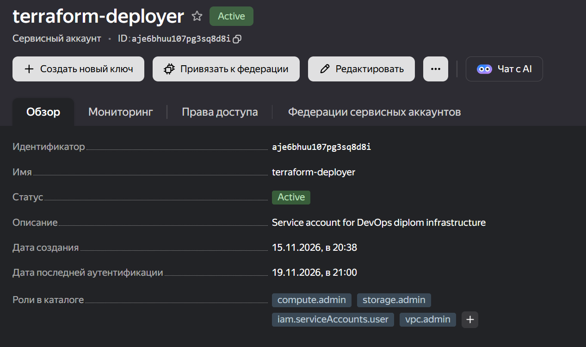
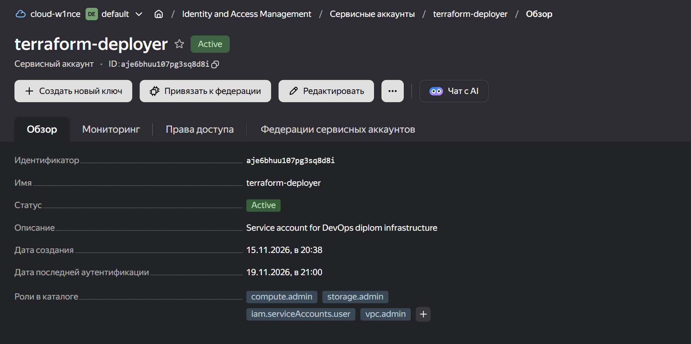

#### Настраиваем удалённый Terraform State
Теперь перенесём State основного проекта из локального файла в созданный бакет. Это позволит хранить состояние инфраструктуры централизованно.
Находясь в директории bootstrap выполним
```bash
export AWS_ACCESS_KEY_ID="$(terraform output -raw access_key)"
export AWS_SECRET_ACCESS_KEY="$(terraform output -raw secret_key)"
```
Перейдем в каталог инфраструктуры и настроим [backend.tf](https://github.com/w1ncez/Devops-Diplom-Project/blob/main/terraform/infrastructure/backend.tf)

> Здесь:
> - bucket указывает на созданное хранилище.
> - key задаёт путь к файлу состояния внутри бакета.
> - endpoints указывает на S3 API Yandex Cloud.
> - skip_* отключают проверки AWS-специфичных параметров, которые не нужны для Yandex Object Storage.

Инициализируем backend, после чего настроим [providers.tf](https://github.com/w1ncez/Devops-Diplom-Project/blob/main/terraform/infrastructure/providers.tf) , [variables.tf](https://github.com/w1ncez/Devops-Diplom-Project/blob/main/terraform/infrastructure/variables.tf) и **terraform.tfvars**, они будут схожи с bootstrap манифестами

```bash
terraform fmt
terraform init
terraform validate
```

#### Создание VPC и подсетей
Для Kubernetes-кластера создадим одну виртуальную сеть и три подсети в разных зонах доступности.

##### Планируем адресацию
VPC: devops-network

Общая адресация: 10.10.0.0/16<br>
*ru-central1-a*
10.10.1.0/24
Master Node

*ru-central1-d*
10.10.2.0/24
Worker Node 1

*ru-central1-e*
10.10.3.0/24
Worker Node 2

> Такое разделение позволит разместить узлы Kubernetes в разных зонах доступности. При этом они останутся в одной VPC и смогут взаимодействовать по внутренним IP-адресам.

Теперь настроим [network.tf](https://github.com/w1ncez/Devops-Diplom-Project/blob/main/terraform/infrastructure/network.tf)

В нём опишем:
- одну виртуальную сеть VPC;
- три подсети в разных зонах доступности;
- адресное пространство 10.10.0.0/16;
- отдельные диапазоны IP для Master и Worker узлов.

Проверим план, затем применим его:
```bash
terraform plan
terraform apply
```


Проверим список сетей и подсетей через yc
```bash
yc vpc network list
yc vpc subnet list
```
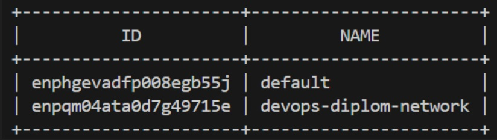


Создано: 
1. yandex_vpc_network.main - виртуальная сеть.
2. yandex_vpc_subnet.master - подсеть Control Plane.
3. yandex_vpc_subnet.worker_1 - подсеть первого Worker.
4. yandex_vpc_subnet.worker_2 - подсеть второго Worker.
Все три подсети находятся в одной VPC, но в разных зонах доступности.

#### Настраиваем Security Groups
Теперь необходимо определить, какой сетевой трафик разрешён между виртуальными машинами и извне.

Для Kubernetes нам понадобятся следующие порты:
| Порт	|Назначение|	Источник|
|----|----|----|
TCP 22|	SSH	| Внешний IP
TCP 6443|	Kubernetes API|	Внутренняя сеть и твой IP
TCP 2379-2380	|etcd	|Control Plane
TCP 10250	|Kubelet API|	Внутренняя сеть
UDP 4789	|Calico VXLAN|	Внутренняя сеть
TCP 30000-32767|	NodePort|	При необходимости

Настроим [security.tf](https://github.com/w1ncez/Devops-Diplom-Project/blob/main/terraform/infrastructure/security.tf) и применим манифест.
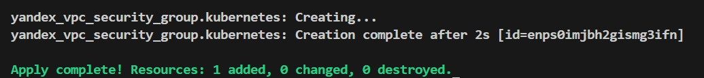

#### Создание виртуальных машин
Теперь подготовим три ВМ:
- master-1: узел управления Kubernetes.
- worker-1: первый рабочий узел.
- worker-2: второй рабочий узел.

Работать будем с такой конфигурацией:
|Параметр|	Master|	Worker|
|----|----|----|
vCPU|	2|	2
RAM	|4 ГБ|	4 ГБ
Диск	|30 ГБ|	20 ГБ
ОС	|Ubuntu 24.04.5 LTS|	Ubuntu 24.04.5 LTS
Публичный IP|	Да|	Да


> Публичные IP на всех узлах упростят первоначальную настройку Ansible и подключение по SSH

Подготовим [compute.tf](https://github.com/w1ncez/Devops-Diplom-Project/blob/main/terraform/infrastructure/compute.tf) и [outputs.tf](https://github.com/w1ncez/Devops-Diplom-Project/blob/main/terraform/infrastructure/outputs.tf)

> Для всех узлов используем образ *image_id = "fd8041m4h84kooeovknf"*

Применим манифест и убедимся, что все ресурсы compute созданы:
```bash
yc compute instance list
```


Итоговая иерархия структуры terraform:
```text
├── bootstrap
│   ├── bootstrap.tfplan
│   ├── main.tf
│   ├── outputs.tf
│   ├── providers.tf
│   ├── terraform.tfstate
│   ├── terraform.tfstate.backup
│   ├── terraform.tfvars
│   └── variables.tf
└── infrastructure
    ├── backend.tf
    ├── compute.tf
    ├── network.tf
    ├── outputs.tf
    ├── providers.tf
    ├── security.tf
    ├── terraform.tfvars
    ├── terraform.tfstate
    ├── tfplan
    └── variables.tf
```

## 2. Запуск и конфигурация Kubernetes кластера

Будем использовать связку containerd + kubeadm + kubelet + kubectl, а автоматизацию выполнять через Ansible. Это позволит не настраивать каждый сервер вручную и будет соответствовать архитектуре дипломного проекта.

### Проверка исходного состояния серверов
Перед установкой Kubernetes проверим операционную систему, ресурсы, swap и сетевые интерфейсы.
Скрипт проверки предикатов:
```bash
for ip in 84.201.173.43 81.26.188.0 93.77.160.168; do
    echo
    echo "========== $ip =========="

    ssh -i /home/w1nce/id_ed25519 \
        -o ConnectTimeout=10 \
        ubuntu@"$ip" '
        echo "--- HOSTNAME ---"
        hostname

        echo "--- OS ---"
        grep -E "PRETTY_NAME|VERSION_ID" /etc/os-release

        echo "--- CPU ---"
        nproc

        echo "--- MEMORY ---"
        free -h

        echo "--- DISK ---"
        df -h /

        echo "--- SWAP ---"
        sudo swapon --show

        echo "--- NETWORK ---"
        ip -br addr
    '
done
```

Результаты проверки:
Параметр	|Master	|Worker 1	|Worker 2
|----|----|----|----|
Версия ОС	|Ubuntu 24.04.5	|Ubuntu 24.04.5	|Ubuntu 24.04.5
CPU	|2	|2	|2
RAM	|3.8 GiB	|3.8 GiB	|3.8 GiB
Свободная RAM	|3.4 GiB	|3.4 GiB	|3.5 GiB
Диск	|29 GB	|19 GB	|19 GB
Swap	|Выключен	|Выключен	|Выключен
Внутренний IP	|10.10.1.10	|10.10.2.10	|10.10.3.10

#### Настраиваем Ansible

Подготовим [inventory/hosts.ini](https://github.com/w1ncez/Devops-Diplom-Project/blob/main/ansible/inventory/hosts.ini)

Проведем проверки 
```bash
ansible-inventory -i inventory/hosts.ini --graph
@all:
  |--@ungrouped:
  |--@kubernetes:
  |  |--@masters:
  |  |  |--master-1
  |  |--@workers:
  |  |  |--worker-1
  |  |  |--worker-2
```
```bash
ansible -i inventory/hosts.ini kubernetes -m ping
master-1 | SUCCESS => {
    "changed": false,
    "ping": "pong"
}
worker-2 | SUCCESS => {
    "changed": false,
    "ping": "pong"
}
worker-1 | SUCCESS => {
    "changed": false,
    "ping": "pong"
}
```
#### Создание Ansible-роли подготовки серверов

Подготовим [group_vars/kubernetes.yml](https://github.com/w1ncez/Devops-Diplom-Project/blob/main/ansible/group_vars/kubernetes.yml)

> kubernetes_packages содержит системные зависимости.
> kernel_modules содержит модули ядра, необходимые для сетевой работы контейнеров.
> sysctl_settings содержит параметры маршрутизации и обработки сетевого трафика.

#### Создаём задачи Ansible

 Подготовим [roles/kubernetes_prepare/tasks/main.yml](https://github.com/w1ncez/Devops-Diplom-Project/blob/main/ansible/roles/kubernetes_prepare/tasks/main.yml)

 Здесь мы:
 1. Обновляем индекс пакетов APT.
 2. Устанавливаем системные зависимости.
 3. Отключаем swap, если он включён.
 4. Убираем автоматическое подключение swap через /etc/fstab.
 5. Настраиваем загрузку модулей ядра.
 6. Загружаем необходимые модули.
 7. Настраиваем параметры сетевого стека Linux.

#### Создаём Handler

Подготовим [roles/kubernetes_prepare/handlers/main.yml](https://github.com/w1ncez/Devops-Diplom-Project/blob/main/ansible/roles/kubernetes_prepare/handlers/main.yml)

> Handler выполняется только тогда, когда изменился файл сетевых параметров.

#### Создаём основной Playbook

Подготовим [playbook.yml](https://github.com/w1ncez/Devops-Diplom-Project/blob/main/ansible/playbook.yml)

> Параметр become: true позволяет выполнять системные команды с привилегиями root через sudo.

Проверим синтаксис:
```bash
ansible-playbook -i inventory/hosts.ini playbook.yml --syntax-check

playbook: playbook.yml
```
Запускаем плейбук:
```bash
ansible-playbook -i inventory/hosts.ini playbook.yml
```
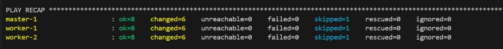
Проведем проверку параметров
```bash
ansible -i inventory/hosts.ini kubernetes -m shell -a \
'lsmod | grep -E "overlay|br_netfilter"; sysctl net.ipv4.ip_forward; swapon --show'
```
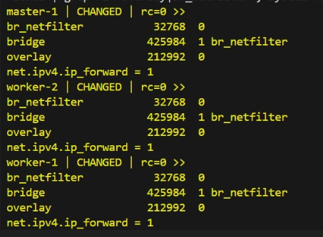

 По результатам видно, что:
 - Все три узла доступны по SSH.
 - Пакеты установлены без ошибок.
 - Swap уже был отключён до запуска Ansible, поэтому задача Disable swap immediately корректно пропустилась.
 - Модули overlay и br_netfilter загружены на всех узлах.
 - net.ipv4.ip_forward = 1 установлен на всех узлах.
 - swapon --show не вывел активных разделов подкачки.
 - Ошибок выполнения нет: failed=0, unreachable=0.

#### Проверка сети перед установкой Kubernetes
Перед установкой containerd и компонентов Kubernetes проверим связь между узлами по внутренним IP-адресам. Это важно, поскольку Kubernetes будет обмениваться служебным трафиком между master и worker-узлами через внутреннюю сеть Yandex Cloud.

Проверяем сетевую связность
```bash
ansible -i inventory/hosts.ini kubernetes -m shell -a \
'for ip in 10.10.1.10 10.10.2.10 10.10.3.10; do
  echo "Checking $ip"
  ping -c 3 -W 2 "$ip"
done'
```
Проверимм синхронизацию времени
```bash
ansible -i inventory/hosts.ini kubernetes -m shell -a \
'timedatectl status'
```
После того, как проверки пройдены, приступаем к настройке установке Kubernetes.<br>

Для установки будем использовать:
- containerd как контейнерную среду выполнения;
- kubeadm для создания кластера;
- kubelet для управления Pod на каждом узле;
- kubectl для управления кластером.
  
> Для containerd настроим драйвер cgroup systemd, рекомендованный документацией Kubernetes для систем с cgroup v2.
> Устанавливать всё будем через отдельную Ansible-роль, чтобы впоследствии можно было повторно развернуть инфраструктуру одной командой.

#### Установка containerd и Kubernetes

##### Архитектура установки
На всех трёх серверах установим:
Компонент	|Назначение
---|---
containerd	|Запуск контейнеров
kubelet	|Управление Pod на узле
kubeadm	|Инициализация и подключение узлов
kubectl	|Управление кластером

##### Добавляем переменные

Добавим в **group_vars/kubernetes.yml** переменные:

```yml
# Kubernetes version
kubernetes_minor_version: "1.37"

# Container runtime
containerd_package: containerd.io
containerd_config_path: /etc/containerd/config.toml
```
> Переменная kubernetes_minor_version позволит в дальнейшем централизованно менять ветку Kubernetes.

##### Создаём новую Ansible-роль

[roles/kubernetes_install/tasks/main.yml](https://github.com/w1ncez/Devops-Diplom-Project/blob/main/ansible/roles/kubernetes_install/tasks/main.yml)

##### Создаём Handler

[roles/kubernetes_install/handlers/main.yml](https://github.com/w1ncez/Devops-Diplom-Project/blob/main/ansible/roles/kubernetes_install/handlers/main.yml)

##### Подключаем роль к Playbook, добавляя

```yml
 roles:
    - kubernetes_install
```
##### Проверяем конфигурацию
```bash
ansible-playbook -i inventory/hosts.ini playbook.yml --syntax-check
ansible-playbook -i inventory/hosts.ini playbook.yml --list-hosts
```
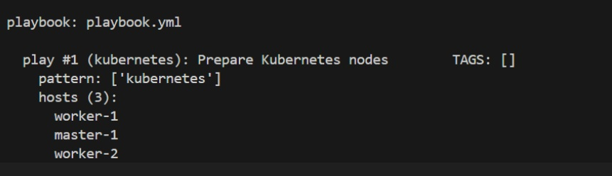

#### Запускаем установку
```bash
ansible-playbook -i inventory/hosts.ini playbook.yml
```
Проверим:
```bash
ansible -i inventory/hosts.ini kubernetes -m shell -a \
'containerd --version; kubelet --version; kubeadm version -o short; kubectl version --client'
```
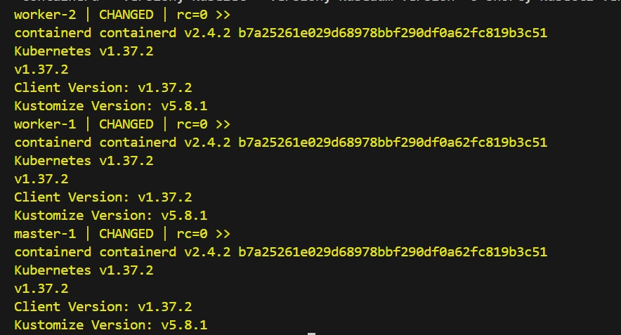
```bash
ansible -i inventory/hosts.ini kubernetes -m shell -a \
'systemctl is-active containerd; systemctl is-enabled containerd; systemctl is-enabled kubelet'
```
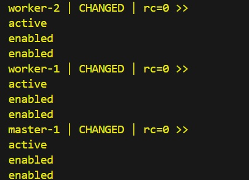
```bash
ansible -i inventory/hosts.ini kubernetes -m shell -a \
'grep -n "SystemdCgroup" /etc/containerd/config.toml'
```
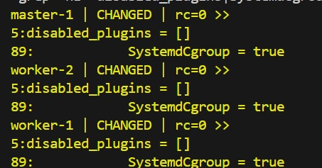
```bash
ansible -i inventory/hosts.ini kubernetes -b -m shell -a \
'ctr plugins ls | grep cri'
```
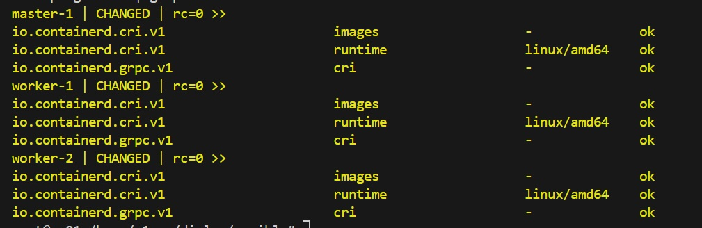

##### Cоздание Kubernetes control plane

Для Pod Network будем использовать Calico с сетью 192.168.0.0/16. Она не пересекается с нашими подсетями Yandex Cloud 10.10.1.0/24, 10.10.2.0/24 и 10.10.3.0/24.

##### Подготовка конфигурации kubeadm
Будем использовать официальный формат конфигурации kubeadm.k8s.io/v1beta4. Он позволяет явно задать адрес API Server, версию Kubernetes, Pod CIDR и CRI socket. 

Создаём шаблон конфигурации

[roles/kubernetes_control_plane/templates/kubeadm-init.yaml.j2](https://github.com/w1ncez/Devops-Diplom-Project/blob/main/ansible/roles/kubernetes_control_plane/templates/kubeadm-init.yaml.j2)

В шаблоне:
- advertiseAddress определяет внутренний адрес API Server.
- bindPort задаёт порт Kubernetes API.
- criSocket явно указывает containerd.
- kubernetesVersion фиксирует версию компонентов control plane.
- podSubnet задаёт диапазон IP-адресов для Pod.
- serviceSubnet задаёт диапазон IP-адресов Kubernetes Services.

##### Создаём задачи Ansible

[roles/kubernetes_control_plane/tasks/main.yml](https://github.com/w1ncez/Devops-Diplom-Project/blob/main/ansible/roles/kubernetes_control_plane/tasks/main.yml)

Подключаем роль в Playbook
```yml
- name: Configure Kubernetes control plane
  hosts: masters
  become: true
  gather_facts: false

  roles:
    - kubernetes_control_plane 
```
##### Загрузка образов Kubernetes

Перед инициализацией кластера загрузим необходимые контейнерные образы. Это позволит заранее проверить доступность registry и не прерывать инициализацию из-за отсутствующих образов.

```bash
ssh -i /home/w1nce/id_ed25519 ubuntu@84.201.173.43 \
'sudo kubeadm config images pull --config /etc/kubernetes/kubeadm-init.yaml'
```

Проверка:
```bash
ssh -i /home/w1nce/id_ed25519 ubuntu@84.201.173.43 \
'sudo ctr -n k8s.io images ls'
```
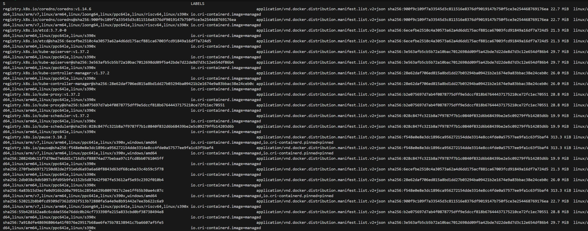

Образы на месте, перейдём к инициализации control plane:
```bash
ssh -i /home/w1nce/id_ed25519 ubuntu@84.201.173.43 \
'sudo kubeadm init --config /etc/kubernetes/kubeadm-init.yaml'
```

##### Настраиваем kubectl
Сейчас файл /etc/kubernetes/admin.conf содержит параметры подключения и сертификаты администратора Kubernetes.

Настроим доступ для пользователя ubuntu, чтобы не приходилось каждый раз использовать sudo kubectl.
```bash
ssh -i /home/w1nce/id_ed25519 ubuntu@84.201.173.43 '
mkdir -p ~/.kube &&
sudo cp /etc/kubernetes/admin.conf ~/.kube/config &&
sudo chown ubuntu:ubuntu ~/.kube/config
'
```

### Устанавливаем Calico

Calico обеспечивает:
- Сетевую связность между Pod.
- Маршрутизацию трафика между узлами.
- Сетевые политики Kubernetes.
- Интеграцию с Kubernetes CNI.

> Мы указали Pod CIDR 192.168.0.0/16 при инициализации кластера, Calico должен использовать именно эту сеть.


Загружаем манифест **Calico**
```bash
mkdir -p kubernetes/manifests

curl -L https://raw.githubusercontent.com/projectcalico/calico/v3.31.3/manifests/calico.yaml \
-o kubernetes/manifests/calico.yaml
```

Устанавливаем Calico на master-1 через SSH
```bash
ssh -i /home/w1nce/id_ed25519 ubuntu@84.201.173.43 \
'kubectl apply -f -' \
< kubernetes/manifests/calico.yaml
```
Проверка:
```bash
ssh -i /home/w1nce/id_ed25519 ubuntu@84.201.173.43 \
'kubectl get pods -n kube-system -o wide'

ssh -i /home/w1nce/id_ed25519 ubuntu@84.201.173.43 \
'kubectl get nodes -o wide'
```
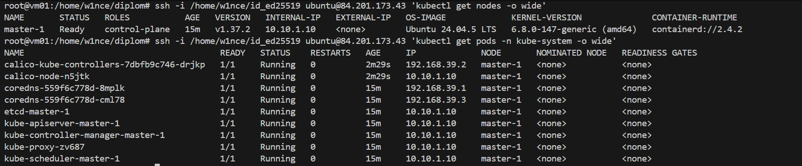

Перед подключением Worker-узлов проверяем доступность API Server:
```bash
for ip in 81.26.188.0 93.77.160.168; do
  echo "Проверка worker: $ip"
  ssh -i /home/w1nce/id_ed25519 ubuntu@$ip \
  'nc -zv -w 5 10.10.1.10 6443'
done
```

Создаём новый токен подключения
```bash
ssh -i /home/w1nce/id_ed25519 ubuntu@84.201.173.43 \
'sudo kubeadm token create --print-join-command'
```
После получения токена дополним playbook:
```yaml
- name: Generate Kubernetes join command
  hosts: masters
  become: true
  gather_facts: false

  tasks:
    - name: Generate kubeadm join command
      ansible.builtin.command:
        cmd: kubeadm token create --print-join-command
      register: kubeadm_join_command
      changed_when: true
      no_log: true
      run_once: true

- name: Join worker nodes to Kubernetes cluster
  hosts: workers
  become: true
  gather_facts: false

  tasks:
    - name: Join worker to Kubernetes cluster
      ansible.builtin.command:
        cmd: "{{ hostvars[groups['masters'][0]].kubeadm_join_command.stdout }}"
        creates: /etc/kubernetes/kubelet.conf
      no_log: true
```
Здесь:
1. Ansible подключается к master-1.
2. Создаёт новый токен и формирует команду kubeadm join.
3. Сохраняет команду во внутреннюю переменную Ansible.
4. no_log: true скрывает секретные данные в выводе.
5. Подключается к worker-1 и worker-2.
6. Выполняет kubeadm join на каждом узле.

Запускаем подключение
```bash
ansible-playbook -i inventory/hosts.ini playbook.yml
```

Проверяем кластер

```bash
ssh -i /home/w1nce/id_ed25519 ubuntu@84.201.173.43 'kubectl get nodes -o wide'
```
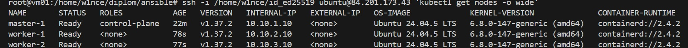
```bash
ssh -i /home/w1nce/id_ed25519 ubuntu@84.201.173.43 \
'kubectl get pods -A -o wide'
```
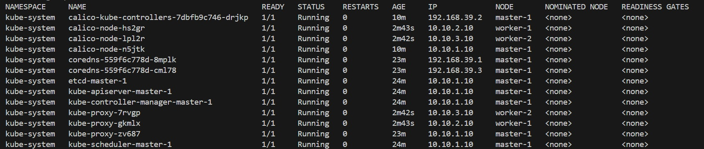

На данном этапе успешно выполнено:
1. Подготовлены три виртуальные машины с помощью Ansible.
2. Установлены containerd и компоненты Kubernetes.
3. Инициализирован Control Plane через kubeadm.
4. Установлен сетевой плагин Calico.
5. Оба Worker-узла присоединены к кластеру.

Структура ansible каталога
```text
ansible/
├── group_vars
│   └── kubernetes.yml
├── inventory
│   └── hosts.ini
├── playbook.yml
└── roles
    ├── kubernetes_control_plane
    │   ├── tasks
    │   │   └── main.yml
    │   └── templates
    │       └── kubeadm-init.yaml.j2
    ├── kubernetes_install
    │   ├── handlers
    │   │   └── main.yml
    │   └── tasks
    │       └── main.yml
    └── kubernetes_prepare
        ├── handlers
        │   └── main.yml
        └── tasks
            └── main.yml
```


## 3. Создание тестового приложения и настройка CI/CD

Создадим GitHub репозиторий приложения:
[nginx-static-app](https://github.com/w1ncez/nginx-static-app)

Наше статичное nginx-приложение будет содержать:
- index.html: главная страница сайта.
- default.conf: конфигурация Nginx.
- Dockerfile: инструкция для сборки Docker-образа.
- .dockerignore: исключения для контекста сборки.
- README.md: описание приложения.

```
nginx-static-app/
├── html/
│   └── index.html
├── conf/
│   └── default.conf
├── Dockerfile
├── .dockerignore
└── README.md
```

Подготовим главную страницу сайта **html/index.html**:
```html
<!DOCTYPE html>
<html lang="ru">
<head>
    <meta charset="UTF-8">
    <meta name="viewport" content="width=device-width, initial-scale=1.0">
    <title>DevOps Diplom Project</title>
    <style>
        body {
            margin: 0;
            font-family: Arial, sans-serif;
            background: #f3f4f6;
            color: #1f2937;
        }

        .container {
            max-width: 800px;
            margin: 100px auto;
            padding: 40px;
            background: white;
            border-radius: 12px;
            text-align: center;
            box-shadow: 0 4px 12px rgba(0, 0, 0, 0.08);
        }

        h1 {
            color: #2563eb;
        }

        .status {
            color: #16a34a;
            font-weight: bold;
        }
    </style>
</head>
<body>
    <div class="container">
        <h1>DevOps Diplom Project</h1>
        <p>Статическое веб-приложение на базе Nginx.</p>
        <p>Приложение развёрнуто в Kubernetes.</p>
        <p class="status">Application status: OK</p>
        <hr>
        <p>Infrastructure: Yandex Cloud</p>
        <p>Container runtime: containerd</p>
        <p>Orchestration: Kubernetes</p>
        <p>Automation: Terraform, Ansible, GitHub Actions</p>
        <p>Monitoring: Grafana, Prometheus, Alertmanager, Nodeexporter</p>
    </div>
</body>
</html>
```
Подготовим конфигурацию nginx **conf/default.conf**:
```nginx
server {
    listen 80;
    server_name _;

    root /usr/share/nginx/html;
    index index.html;

    location / {
        try_files $uri $uri/ =404;
    }

    location = /health {
        access_log off;
        default_type text/plain;
        return 200 "OK\n";
    }
}
```

Подготовим **Dockerfile**:

```dockerfile
FROM nginx:1.28.0-alpine

LABEL maintainer="DevOps Diplom Project"

COPY conf/default.conf /etc/nginx/conf.d/default.conf

COPY html/ /usr/share/nginx/html/

EXPOSE 80

CMD ["nginx", "-g", "daemon off;"]
```
> В доработанной версии мы используем конкретную версию базового образа nginx:1.28.0-alpine вместо плавающего тега nginx:stable-alpine.

Находясь в репозитории, запустим сборку образа:

```bash
sudo docker build -t nginx-static-app:1.0 .
```
```bash
Successfully tagged nginx-static-app:1.0
```
Проверим создание образа:
```bash
sudo docker images                                                                             
IMAGE                                    ID             DISK USAGE   CONTENT SIZE   EXTRA   
nginx:1.28.0-alpine                     30f1c0d78e0a       73.7MB           21MB        
```
И запустим контейнер:
```bash
sudo docker run -d \
  --name nginx-static-app \
  -p 8080:80 \
  nginx-static-app:1.0
```
Проверим его запуск:
```bash
sudo docker ps
CONTAINER ID   IMAGE                  COMMAND                  CREATED         STATUS         PORTS                                     NAMES
4c5de0191755   nginx-static-app:1.0   "/docker-entrypoint.…"   6 seconds ago   Up 5 seconds   0.0.0.0:8080->80/tcp, [::]:8080->80/tcp   nginx-static-app
```
И проверим работу nginx:
```bash
curl -I http://localhost:8080
HTTP/1.1 200 OK
Server: nginx/1.28.0
Date: Sat, 28 Nov 2026 15:41:13 GMT
Content-Type: text/html
Content-Length: 1379
Last-Modified: Fri, 27 Nov 2026 13:48:53 GMT
Connection: keep-alive
ETag: "6b098a45-563"
Accept-Ranges: bytes
```
На данном этапе:
1. Создан репозиторий для приложений.
2. Создана страница сайта.
3. Настроен nginx.
4. Подготовлен Dockerfile.
5. Приложение запущено и доступно.

## Развёртывание приложения в Kubernetes

Далее необходимо запустить наше Nginx-приложение в ранее созданном трёхузловом Kubernetes-кластере, используя образ из GHCR.

Предлагаемая конфигурация:
Параметр|	Значение
---|---
Namespace	|diplom
Deployment	|nginx-static-app
Количество реплик	|3
Container port	|80
Service	|NodePort
Health checks	|Readiness и Liveness probes
Image	|ghcr.io/w1ncez/nginx-static-app:1.28.0

Начнем с создания манифестов [namespace.yaml](https://github.com/w1ncez/Devops-Diplom-Project/blob/main/kubernetes/manifests/app/namespace.yaml), [deployment.yaml](https://github.com/w1ncez/Devops-Diplom-Project/blob/main/kubernetes/manifests/app/deployment.yaml) и [service.yaml](https://github.com/w1ncez/Devops-Diplom-Project/blob/main/kubernetes/manifests/app/service.yaml)

В них опишем:
- пространство имён;
- запуск приложения;
- сетевой доступ к Pod.

Далее приступим к применению:
```bash
ssh -i /home/w1nce/id_ed25519 ubuntu@84.201.173.43 \
'kubectl apply -f -' \
< kubernetes/manifests/app/namespace.yaml
```
```bash
ssh -i /home/w1nce/id_ed25519 ubuntu@84.201.173.43 \
'kubectl apply -f -' \
< kubernetes/manifests/app/deployment.yaml
```
```bash
ssh -i /home/w1nce/id_ed25519 ubuntu@84.201.173.43 \
'kubectl apply -f -' \
< kubernetes/manifests/app/service.yaml
```
После чего, через некоторое время произведем проверки, что все корректно создалось:
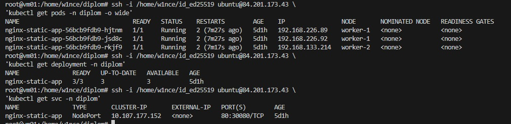
И проверку работы нашего приложения:
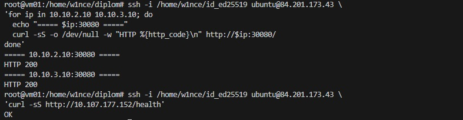

На данном этапе реализовано:
1. Созданы необходимые манифесты;
2. Приложение развернуто в кластере Kubernetes.
3. Размещено приложение только на Worker-узлах.
4. Настроена Балансировка Pod между узлами.
5. Настроено получение образа из публичного GHCR.
6. Настроено ограничение CPU и памяти.
7. Произведена проверка корректности работы приложения.

### Настройка workflow в GitHub Actions

В рамках первоначальной настройки workflow зарегистрируем self-hosted runner согласно пошаговому [гайду от GH](https://docs.github.com/en/actions/how-tos/manage-runners/self-hosted-runners/add-runners).

В первоначальной реализации workflow запускался при отправке изменений в ветку `main` и публиковал образ с тегом `latest`. В итоговой реализации workflow запускается при публикации Git-тега, соответствующего шаблону `v*` (например, `v1.0.0`, `v1.0.1`, `v1.0.2`), что позволяет жёстко связать версию релиза с образом в GHCR.

Для выполнения второго задания (`deploy`) используется self-hosted runner, установленный как системная служба на узле `worker-1`. Это позволяет не поднимать отдельную виртуальную машину под runner и выполнять развёртывание из среды с доступом к Kubernetes API Server. При этом команда `kubectl set image` обновляет образ непосредственно в Deployment кластера (без автоматического коммита изменений обратно в `kubernetes/manifests/app/deployment.yaml`).

Примеры версий:
```text
v1.0.0
v1.0.1
v1.0.2
```
Это позволяет связывать конкретную версию исходного кода с соответствующей версией Docker-образа.

Создадим в репозитории .github/workflows/docker-build.yml со следующим содержимым:
```yaml
name: Build, Publish and Deploy

on:
  push:
    tags:
      - 'v*'

permissions:
  contents: read

jobs:
  build-and-push:
    name: Build and Push Docker Image
    runs-on: ubuntu-latest

    permissions:
      contents: read
      packages: write

    steps:
      - name: Checkout repository
        uses: actions/checkout@v4

      - name: Build Docker image for testing
        run: docker build -t nginx-static-app:test .

      - name: Validate Nginx configuration
        run: docker run --rm nginx-static-app:test nginx -t

      - name: Test application health endpoint
        run: |
          docker run -d --name nginx-test -p 8080:80 nginx-static-app:test
          trap 'docker rm -f nginx-test >/dev/null 2>&1 || true' EXIT

          for i in {1..10}; do
            if curl --fail http://localhost:8080/health; then
              exit 0
            fi
            sleep 2
          done

          exit 1

      - name: Set up Docker Buildx
        uses: docker/setup-buildx-action@v3

      - name: Log in to GHCR
        uses: docker/login-action@v3
        with:
          registry: ghcr.io
          username: ${{ github.actor }}
          password: ${{ secrets.GITHUB_TOKEN }}

      - name: Extract Docker metadata
        id: meta
        uses: docker/metadata-action@v5
        with:
          images: ghcr.io/w1ncez/nginx-static-app
          tags: |
            type=ref,event=tag
            type=sha,format=short

      - name: Build and push Docker image
        uses: docker/build-push-action@v6
        with:
          context: .
          push: true
          tags: ${{ steps.meta.outputs.tags }}
          labels: ${{ steps.meta.outputs.labels }}

  deploy:
    name: Deploy to Kubernetes
    needs: build-and-push
    runs-on: [self-hosted, Linux, X64]

    permissions:
      contents: read

    steps:
      - name: Configure Kubernetes access
        env:
          KUBE_CONFIG_B64: ${{ secrets.KUBE_CONFIG_B64 }}
        run: |
          set -euo pipefail

          mkdir -p "$RUNNER_TEMP/kube"
          printf '%s' "$KUBE_CONFIG_B64" | base64 --decode \
            > "$RUNNER_TEMP/kube/config"

          chmod 600 "$RUNNER_TEMP/kube/config"

          echo "KUBECONFIG=$RUNNER_TEMP/kube/config" >> "$GITHUB_ENV"

      - name: Verify Kubernetes access
        run: |
          set -euo pipefail

          echo "Checking access to application namespace..."

          kubectl get deployment nginx-static-app -n diplom

          test "$(kubectl auth can-i get deployments -n diplom)" = "yes"
          test "$(kubectl auth can-i patch deployments -n diplom)" = "yes"
          test "$(kubectl auth can-i delete deployments -n diplom)" = "no"
          test "$(kubectl auth can-i get secrets -n diplom)" = "no"

          echo "Kubernetes RBAC checks passed"

      - name: Update Kubernetes Deployment
        env:
          IMAGE_TAG: ${{ github.ref_name }}
        run: |
          set -euo pipefail

          IMAGE="ghcr.io/w1ncez/nginx-static-app:${IMAGE_TAG}"

          echo "Deploying image: ${IMAGE}"

          kubectl set image deployment/nginx-static-app \
            nginx="${IMAGE}" \
            -n diplom

      - name: Verify deployment rollout
        run: |
          set -euo pipefail

          kubectl rollout status deployment/nginx-static-app \
            -n diplom \
            --timeout=180s

          kubectl get deployment nginx-static-app -n diplom -o wide

      - name: Cleanup kubeconfig
        if: always()
        run: |
          rm -rf "$RUNNER_TEMP/kube"
```
Рассмотрим измененную версию:

#### Первое задание **Build and Push Docker Image**
Выполняется на стандартном GitHub-hosted runner с операционной системой Ubuntu.

Последовательность действий:
1. Checkout repository получает исходный код проекта из GitHub.
2. Build Docker image for testing собирает локальный Docker-образ для последующего тестирования.
3. Validate Nginx configuration проверяет корректность конфигурации Nginx командой nginx -t.
4. Test application health endpoint запускает временный контейнер и проверяет доступность /health. При неудачной проверке сборка завершается с ошибкой.
5. Set up Docker Buildx подготавливает инструмент сборки Docker-образов.
6. Log in to GHCR выполняет авторизацию в GitHub Container Registry с использованием встроенного GITHUB_TOKEN.
7. Extract Docker metadata формирует теги для Docker-образа на основании Git-тега и короткого SHA коммита.
8. Build and push Docker image собирает итоговый образ и публикует его в GHCR.

Например, при создании Git-тега v1.0.2 публикуется образ:
```text
ghcr.io/w1ncez/nginx-static-app:v1.0.2
```
Дополнительно создаётся тег с коротким SHA коммита, что позволяет идентифицировать исходный код, использованный для сборки.

#### Второе задание **Deploy to Kubernetes**

Второе задание запускается только после успешного выполнения build-and-push. Это обеспечивается параметром:
```yaml
needs: build-and-push
```
Для выполнения развёртывания используется self-hosted GitHub Actions runner, установленный на существующем узле worker-1 Kubernetes-кластера.
Такой подход позволяет не создавать дополнительную виртуальную машину и выполнять операции развёртывания из среды, имеющей сетевой доступ к Kubernetes API Server.

Последовательность действий:
1. Configure Kubernetes access декодирует kubeconfig, полученный из GitHub Repository Secret KUBE_CONFIG_B64, и устанавливает переменную окружения KUBECONFIG.
2. Verify Kubernetes access проверяет доступ к Deployment в namespace diplom и проверяет разрешения ServiceAccount.
3. Update Kubernetes Deployment формирует имя Docker-образа на основании Git-тега и обновляет контейнер nginx в Deployment.
4. Verify deployment rollout ожидает завершения обновления и проверяет состояние Deployment.
5. Cleanup kubeconfig удаляет временный файл конфигурации Kubernetes после выполнения задания.

Для обновления приложения используется команда:
```bash
kubectl set image deployment/nginx-static-app \
  nginx="ghcr.io/w1ncez/nginx-static-app:${IMAGE_TAG}" \
  -n diplom
```
Таким образом, Kubernetes получает новую версию образа без необходимости вручную изменять манифест Deployment.

#### Настройка доступа GitHub Actions к Kubernetes

Для автоматизированного развёртывания необходимо предоставить GitHub Actions доступ к Kubernetes API.
Вместо использования административной учётной записи кластера создадим отдельную ServiceAccount в **github-actions-rbac.yaml**

```yaml
apiVersion: v1
kind: ServiceAccount
metadata:
  name: github-actions-deployer
  namespace: diplom
---
apiVersion: rbac.authorization.k8s.io/v1
kind: Role
metadata:
  name: github-actions-deployer
  namespace: diplom
rules:
  - apiGroups: ["apps"]
    resources: ["deployments"]
    verbs: ["get", "list", "watch", "patch", "update"]
  - apiGroups: ["apps"]
    resources: ["replicasets"]
    verbs: ["get", "list", "watch"]
  - apiGroups: [""]
    resources: ["pods"]
    verbs: ["get", "list", "watch"]
---
apiVersion: rbac.authorization.k8s.io/v1
kind: RoleBinding
metadata:
  name: github-actions-deployer
  namespace: diplom
subjects:
  - kind: ServiceAccount
    name: github-actions-deployer
    namespace: diplom
roleRef:
  apiGroup: rbac.authorization.k8s.io
  kind: Role
  name: github-actions-deployer
```
Здесь используются три объекта Kubernetes:
- ServiceAccount представляет отдельную учётную запись для автоматизированного процесса.
- Role определяет разрешённые операции с ресурсами внутри namespace diplom.
- RoleBinding связывает ServiceAccount с созданной ролью.

Роль предоставляет права на чтение и обновление Deployment, а также чтение ReplicaSet и Pod.
При этом учётная запись не может удалять Deployment или читать Secrets. Это позволяет ограничить полномочия CI/CD необходимым минимумом.

Для аутентификации был создан ServiceAccount token, а kubeconfig подготовлен с использованием адреса Kubernetes API Server, CA-сертификата и токена.
Полученный kubeconfig был сохранён в GitHub Repository Secrets под именем:
**KUBE_CONFIG_B64**
Значение секрета используется непосредственно в workflow и не хранится в открытом виде в репозитории.
Дополнительно self-hosted runner зарегистрирован в репозитории w1ncez/nginx-static-app и работает как системная служба на узле worker-1.

#### Проверка автоматизированного CI/CD и развёртывания

После настройки workflow и доступа к Kubernetes выполним публикацию новой версии приложения.

Создадим аннотированный Git-тег
```bash
git tag -a v1.0.2 -m "Release version 1.0.2"
```
Отправим тег в GitHub:
```bash
git push origin v1.0.2
```
После публикации тега GitHub Actions автоматически запускает workflow Build, Publish and Deploy.

В ходе выполнения проверяются:
- Сборка Docker-образа.
- Корректность конфигурации Nginx.
- Доступность HTTP-эндпоинта /health.
- Авторизация в GitHub Container Registry.
- Публикация Docker-образа с версионным тегом.
- Подключение к Kubernetes.
- Проверка RBAC-разрешений.
- Обновление Deployment.
- Успешность rollout.

Результат публикации образа:
```text
ghcr.io/w1ncez/nginx-static-app:v1.0.2
```
Результат проверки Kubernetes:
```bash
deployment "nginx-static-app" successfully rolled out
```
Состояние Deployment:
```bash
NAME               READY   UP-TO-DATE   AVAILABLE   IMAGES
nginx-static-app   3/3     3            3           ghcr.io/w1ncez/nginx-static-app:v1.0.2
```
Проверка Pod показала, что все три экземпляра приложения находятся в состоянии Running, а количество перезапусков равно нулю:
```bash
NAME                               READY   STATUS    RESTARTS
nginx-static-app-565df5dfc-brhjm   1/1     Running   0
nginx-static-app-565df5dfc-khzt4   1/1     Running   0
nginx-static-app-565df5dfc-sxgvv   1/1     Running   0
```
Реплики размещены на двух рабочих узлах Kubernetes-кластера: worker-1 и worker-2.
Таким образом, подтверждена работа автоматизированного процесса от создания Git-тега до обновления приложения в Kubernetes.

В результате выполнения данного этапа:
- Создан отдельный GitHub-репозиторий для статического веб-приложения.
- Подготовлена главная HTML-страница.
- Настроен Nginx и реализован HTTP health endpoint /health.
- Создан Dockerfile с фиксированной версией базового образа.
- Проверена локальная сборка и работа Docker-контейнера.
- Подготовлены Kubernetes-манифесты для развёртывания приложения.
- Приложение развёрнуто в Kubernetes в трёх экземплярах.
- Настроен Service типа NodePort для доступа к приложению.
- Настроен GitHub Actions для автоматической сборки и тестирования Docker-образа.
- Реализована публикация версионных Docker-образов в GitHub Container Registry.
- Установлен self-hosted GitHub Actions runner на существующем Kubernetes worker-узле.
- Созданы ServiceAccount, Role и RoleBinding для ограниченного доступа к Kubernetes.
- Реализовано автоматическое обновление Kubernetes Deployment после публикации Git-тега.
- Проверено успешное развёртывание версии v1.0.2: три из трёх реплик находятся в состоянии Ready.


## 4. Настройка мониторинга

Для реализации задачи мониторинга мы будем использовать стек **kube-prometheus-stack**, который позволит развернуть основные компоненты мониторинга в нашем кластере Kubernetes.

### Архитектура мониторинга
Компонент | Роль в системе | Основные функции 
 --- | --- | --- 
 **Node Exporter** | Источник метрик | Сбор метрик операционной системы виртуальных машин. 
 **kube-state-metrics** | Источник метрик | Трансляция состояния объектов Kubernetes в формат метрик Prometheus. 
 **Kubernetes / Kubelet** | Источник метрик | Предоставление низкоуровневых метрик работы узлов и контейнеров непосредственно из API-сервера и Kubelet. 
 **Prometheus** | Ядро системы | Периодический сбор метрик со всех источников, их индексация и хранение в временной базе данных. 
 **Grafana** | Визуализация | Запрос данных из Prometheus через PromQL и отображение их на интерактивных дашбордах с настройкой пороговых значений. 
 **Alertmanager** | Оповещения | Прием алармов от Prometheus, их группировка, дедупликация и маршрутизация в каналы связи (Telegram, Email, Slack). 

> Все компоненты мониторинга мы будем устанавливать через Helm, который установим согласно официальной [инструкции](https://helm.sh/docs/v3/intro/install/)

После установки Helm на master-1 установим **Helm chart Metrics Server**, перед этим проверим доступные версии и заданные параметры:
```bash
ubuntu@master-1:~$ helm repo add metrics-server https://kubernetes-sigs.github.io/metrics-server/
helm repo update
"metrics-server" has been added to your repositories
Hang tight while we grab the latest from your chart repositories...
...Successfully got an update from the "metrics-server" chart repository
Update Complete. ⎈Happy Helming!⎈
ubuntu@master-1:~$ helm search repo metrics-server/metrics-server --versions | head -10
NAME                            CHART VERSION   APP VERSION     DESCRIPTION                                       
metrics-server/metrics-server   3.14.0          0.9.0           Metrics Server is a scalable, efficient source ...
metrics-server/metrics-server   3.13.1          0.8.1           Metrics Server is a scalable, efficient source ...
metrics-server/metrics-server   3.13.0          0.8.0           Metrics Server is a scalable, efficient source ...
metrics-server/metrics-server   3.12.2          0.7.2           Metrics Server is a scalable, efficient source ...
metrics-server/metrics-server   3.12.1          0.7.1           Metrics Server is a scalable, efficient source ...
metrics-server/metrics-server   3.12.0          0.7.0           Metrics Server is a scalable, efficient source ...
metrics-server/metrics-server   3.11.0          0.6.4           Metrics Server is a scalable, efficient source ...
metrics-server/metrics-server   3.10.0          0.6.3           Metrics Server is a scalable, efficient source ...
metrics-server/metrics-server   3.9.0           0.6.3           Metrics Server is a scalable, efficient source ...
ubuntu@master-1:~$ helm show values metrics-server/metrics-server --version 3.14.0 | grep -n -A 12 -B 3 '^args:'
101-  - --kubelet-use-node-status-port
102-  - --metric-resolution=15s
103-
104:args: []
105-
106-livenessProbe:
107-  httpGet:
108-    path: /livez
109-    port: https
110-    scheme: HTTPS
111-  initialDelaySeconds: 0
112-  periodSeconds: 10
113-  failureThreshold: 3
114-
115-readinessProbe:
116-  httpGet:
```

Выберем версию Helm chart 3.14.0 и Metrics Server 0.9.0 и приступим к установке.

Создадим файл **metrics-server-values.yaml**:
```yaml
args:
  - --kubelet-insecure-tls

resources:
  requests:
    cpu: 100m
    memory: 200Mi
```

> Нам особенно важен параметр **--kubelet-insecure-tls**.
> В нашем кластере kubelet может использовать сертификаты, которые Metrics Server не сможет проверить через доверенный CA.
> Официальная документация предусматривает этот параметр для таких случаев, но отмечает, что он отключает проверку сертификата и предназначен для тестовых сценариев.


Устанавливаем Metrics Server:
```bash
helm upgrade --install metrics-server \
  metrics-server/metrics-server \
  --version 3.14.0 \
  --namespace kube-system \
  -f metrics-server-values.yaml
```

Далее производим проверку получения метрик:
```bash
ubuntu@master-1:~$ kubectl top nodes
NAME       CPU(cores)   CPU(%)   MEMORY(bytes)   MEMORY(%)   
master-1   139m         6%       1729Mi          45%         
worker-1   49m          2%       899Mi           23%         
worker-2   42m          2%       864Mi           22%         
ubuntu@master-1:~$ kubectl top pods -A
NAMESPACE     NAME                                       CPU(cores)   MEMORY(bytes)   
diplom        nginx-static-app-56bcb9fdb9-hjtnm          1m           3Mi             
diplom        nginx-static-app-56bcb9fdb9-jsd8c          1m           3Mi             
diplom        nginx-static-app-56bcb9fdb9-rkjf9          1m           3Mi             
kube-system   calico-kube-controllers-7dbfb9c746-drjkp   8m           81Mi            
kube-system   calico-node-hs2gr                          22m          183Mi           
kube-system   calico-node-lpl2r                          20m          181Mi           
kube-system   calico-node-n5jtk                          19m          183Mi           
kube-system   coredns-559f6c778d-8mplk                   2m           43Mi            
kube-system   coredns-559f6c778d-cml78                   1m           42Mi            
kube-system   etcd-master-1                              17m          84Mi            
kube-system   kube-apiserver-master-1                    29m          385Mi           
kube-system   kube-controller-manager-master-1           10m          122Mi           
kube-system   kube-proxy-7rvgp                           1m           57Mi            
kube-system   kube-proxy-gkmlx                           1m           58Mi            
kube-system   kube-proxy-zv687                           1m           58Mi            
kube-system   kube-scheduler-master-1                    7m           68Mi            
kube-system   metrics-server-995d47bd7-fsrss             2m           16Mi
```

#### Установка Prometheus и Grafana
Мы будем использовать Helm chart kube-prometheus-stack от сообщества Prometheus.

Он объединяет:
- Prometheus: сбор и хранение метрик.
- Grafana: визуализация и дашборды.
- Alertmanager: обработка оповещений.
- Node Exporter: метрики операционных систем всех трёх VM.
- kube-state-metrics: состояние объектов Kubernetes.
- Prometheus Operator: управление компонентами мониторинга.<br>
Это позволит не устанавливать каждый компонент отдельно.

С учетом потребляемых ресурсов предлагаемая конфигурация следующая:
- одна реплика Prometheus;
- одна реплика Grafana;
- одна реплика Alertmanager;
- минимально необходимые requests и limits;
- хранение метрик в течение 3 дней.

Для установки добавим репозиторий Prometheus:
```bash
ubuntu@master-1:~$ helm repo add prometheus-community \
  https://prometheus-community.github.io/helm-charts
helm repo update
"prometheus-community" has been added to your repositories
Hang tight while we grab the latest from your chart repositories...
...Successfully got an update from the "metrics-server" chart repository
...Successfully got an update from the "prometheus-community" chart repository
Update Complete. ⎈Happy Helming!⎈
```
Касаемо хранения я предпочел остановиться на локальном хранилище VM, т.к. оно не требует покупки дополнительных дисков и данные привязаны к конкретной VM.
Также будет использоваться local-path-provisioner, он будет динамически создавать каталоги на дисках worker-нод и предоставлять их Pod через PVC.
Это позволит сохранять метрики после перезапуска Pod, но не обеспечит сохранность данных при потере самой worker-ноды.

Устанавливаем Local Path Provisioner из репозитория rancher:
```bash
kubectl apply -f https://raw.githubusercontent.com/rancher/local-path-provisioner/v0.0.37/deploy/local-path-storage.yaml
```
Проверим состояние:
```bash
ubuntu@master-1:~$ kubectl get pods -n local-path-storage -o wide
NAME                                      READY   STATUS    RESTARTS   AGE   IP                NODE       NOMINATED NODE   READINESS GATES
local-path-provisioner-7c7ff4f446-mwn57   1/1     Running   0          97s   192.168.133.198   worker-2   <none>           <none>
ubuntu@master-1:~$ kubectl get storageclass
NAME         PROVISIONER             RECLAIMPOLICY   VOLUMEBINDINGMODE      ALLOWVOLUMEEXPANSION   AGE
local-path   rancher.io/local-path   Delete          WaitForFirstConsumer   false                  104s
ubuntu@master-1:~$ kubectl describe storageclass local-path
Name:            local-path
IsDefaultClass:  No
Annotations:     kubectl.kubernetes.io/last-applied-configuration={"apiVersion":"storage.k8s.io/v1","kind":"StorageClass","metadata":{"annotations":{},"name":"local-path"},"provisioner":"rancher.io/local-path","reclaimPolicy":"Delete","volumeBindingMode":"WaitForFirstConsumer"}

Provisioner:           rancher.io/local-path
Parameters:            <none>
AllowVolumeExpansion:  <unset>
MountOptions:          <none>
ReclaimPolicy:         Delete
VolumeBindingMode:     WaitForFirstConsumer
Events:                <none>
```

Следующим шагом создаем неймспейс для мониторинга:
```bash
kubectl create namespace monitoring
```
Создадим манифест **monitoring-values.yaml** в каталоге ~/monitoring/:
```yaml
# Prometheus
prometheus:
  prometheusSpec:
    replicas: 1
    retention: 5d
    retentionSize: "3GB"

    storageSpec:
      volumeClaimTemplate:
        spec:
          storageClassName: local-path
          accessModes:
            - ReadWriteOnce
          resources:
            requests:
              storage: 5Gi

    resources:
      requests:
        cpu: 200m
        memory: 512Mi
      limits:
        cpu: 500m
        memory: 1Gi

# Grafana
grafana:
  enabled: true
  replicas: 1

  persistence:
    enabled: true
    storageClassName: local-path
    accessModes:
      - ReadWriteOnce
    size: 2Gi

  resources:
    requests:
      cpu: 100m
      memory: 128Mi
    limits:
      cpu: 300m
      memory: 256Mi

# Alertmanager
alertmanager:
  enabled: true
  alertmanagerSpec:
    replicas: 1
    storage:
      volumeClaimTemplate:
        spec:
          storageClassName: local-path
          accessModes:
            - ReadWriteOnce
          resources:
            requests:
              storage: 1Gi

    resources:
      requests:
        cpu: 50m
        memory: 64Mi
      limits:
        cpu: 200m
        memory: 128Mi

# Node Exporter
prometheus-node-exporter:
  enabled: true

# kube-state-metrics
kube-state-metrics:
  enabled: true
```
Почему такие параметры:
- Prometheus получает 5 GiB под метрики, срок хранения ограничен пятью днями.
- Grafana получает 2 GiB для своих данных.
- Alertmanager получает 1 GiB.
- Ограничения CPU и RAM помогают избежать чрезмерного потребления ресурсов.
- Используем одну реплику каждого основного компонента, чтобы не перегружать три виртуальные машины.

Запускаем Helm lint:
```bash
ubuntu@master-1:~/monitoring$ helm pull prometheus-community/kube-prometheus-stack \
  --version 93.4.0 \
  --untar
ubuntu@master-1:~/monitoring$ helm lint ./kube-prometheus-stack \
  -f monitoring-values.yaml
==> Linting ./kube-prometheus-stack

1 chart(s) linted, 0 chart(s) failed
```
Устанавливаем kube-prometheus-stack:
```bash
helm upgrade --install monitoring ./kube-prometheus-stack \
  --namespace monitoring \
  -f monitoring-values.yaml \
  --wait \
  --timeout 10m
```
Через некоторое время проверим успешность установки:
```bash
ubuntu@master-1:~/monitoring$ helm list -n monitoring
NAME            NAMESPACE       REVISION        UPDATED                                 STATUS          CHART                          APP VERSION
monitoring      monitoring      1               2026-11-19 18:56:19.474791469 +0000 UTC deployed        kube-prometheus-stack-93.4.0   v0.95.2    
ubuntu@master-1:~/monitoring$ kubectl get pods -n monitoring -o wide
NAME                                                     READY   STATUS    RESTARTS       AGE     IP                NODE       NOMINATED NODE   READINESS GATES
alertmanager-monitoring-kube-prometheus-alertmanager-0   2/2     Running   0              3m7s    192.168.133.204   worker-2   <none>           <none>
monitoring-grafana-747d46fb65-d29hr                      3/3     Running   0              3m24s   192.168.226.76    worker-1   <none>           <none>
monitoring-kube-prometheus-operator-6b77dd6c5b-wtdc5     1/1     Running   0              3m24s   192.168.133.200   worker-2   <none>           <none>
monitoring-kube-state-metrics-7d94c4cbd8-hq9f2           1/1     Running   0              3m24s   192.168.226.74    worker-1   <none>           <none>
monitoring-prometheus-node-exporter-jwll9                1/1     Running   0              3m24s   10.10.3.10        worker-2   <none>           <none>
monitoring-prometheus-node-exporter-t2q6t                1/1     Running   0              3m24s   10.10.2.10        worker-1   <none>           <none>
monitoring-prometheus-node-exporter-wb4lq                1/1     Running   0              3m24s   10.10.1.10        master-1   <none>           <none>
prometheus-monitoring-kube-prometheus-prometheus-0       2/2     Running   0              3m6s    192.168.133.203   worker-2   <none>           <none>
ubuntu@master-1:~/monitoring$ kubectl get pvc -n monitoring
NAME                                                                                                             STATUS   VOLUME                                     CAPACITY   ACCESS MODES   STORAGECLASS   VOLUMEATTRIBUTESCLASS   AGE
alertmanager-monitoring-kube-prometheus-alertmanager-db-alertmanager-monitoring-kube-prometheus-alertmanager-0   Bound    pvc-5d162118-74c3-440a-bd78-31cdf76e6d4d   1Gi        RWO            local-path     <unset>                 3m11s
monitoring-grafana                                                                                               Bound    pvc-4c386b5a-3571-403a-93b2-88b52c4f8a1f   2Gi        RWO            local-path     <unset>                 3m28s
prometheus-monitoring-kube-prometheus-prometheus-db-prometheus-monitoring-kube-prometheus-prometheus-0           Bound    pvc-badbbef2-0074-4f6f-9cb9-3a4025355449   5Gi        RWO            local-path     <unset>                 3m10s
ubuntu@master-1:~/monitoring$ kubectl get pv
NAME                                       CAPACITY   ACCESS MODES   RECLAIM POLICY   STATUS   CLAIM                                                                                                                       STORAGECLASS   VOLUMEATTRIBUTESCLASS   REASON   AGE
pvc-4c386b5a-3571-403a-93b2-88b52c4f8a1f   2Gi        RWO            Delete           Bound    monitoring/monitoring-grafana                                                                                               local-path     <unset>                          3m30s
pvc-5d162118-74c3-440a-bd78-31cdf76e6d4d   1Gi        RWO            Delete           Bound    monitoring/alertmanager-monitoring-kube-prometheus-alertmanager-db-alertmanager-monitoring-kube-prometheus-alertmanager-0   local-path     <unset>                          3m9s
pvc-badbbef2-0074-4f6f-9cb9-3a4025355449   5Gi        RWO            Delete           Bound    monitoring/prometheus-monitoring-kube-prometheus-prometheus-db-prometheus-monitoring-kube-prometheus-prometheus-0           local-path     <unset>                          3m9s
```
Для проверки запустим port-forwarding
```bash
kubectl port-forward -n monitoring svc/monitoring-grafana 3000:80
Forwarding from 127.0.0.1:3000 -> 3000
Forwarding from [::1]:3000 -> 3000
Handling connection for 3000
Handling connection for 3000
Handling connection for 3000
Handling connection for 3000
Handling connection for 3000
Handling connection for 3000
Handling connection for 3000
```
И с другого ПК проверим интерфейс графаны и все источники и метрики, пробросив порт на localhost:
```
ssh -i "C:\Temp\id_ed25519" -L  3000:localhost:3000 ubuntu@84.201.173.43
```
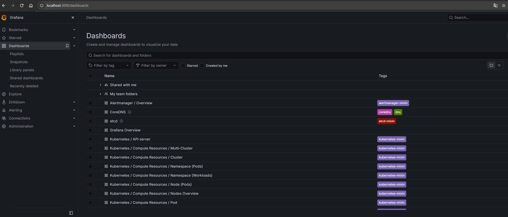
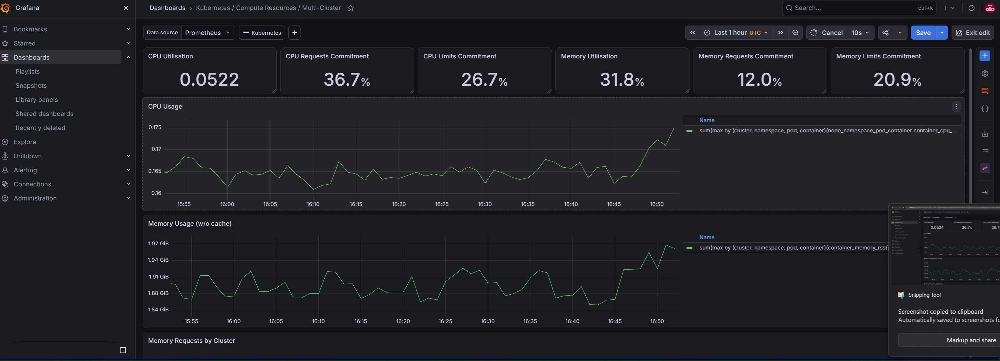
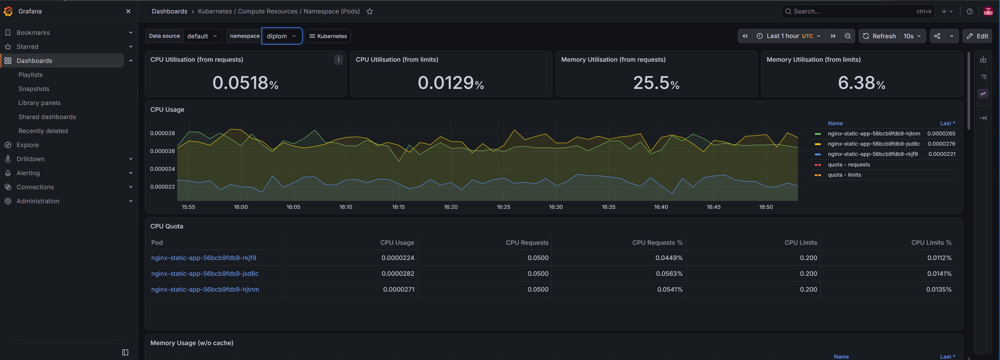

В конце проверим все наши поды во всех неймспейсах и отображение странички нашего приложения:
```
ubuntu@master-1:~$ kubectl get pods --all-namespaces
NAMESPACE            NAME                                                     READY   STATUS    RESTARTS      AGE
diplom               nginx-static-app-56bcb9fdb9-hjtnm                        1/1     Running   3 (72m ago)   5d22h
diplom               nginx-static-app-56bcb9fdb9-jsd8c                        1/1     Running   3 (72m ago)   5d22h
diplom               nginx-static-app-56bcb9fdb9-rkjf9                        1/1     Running   3 (72m ago)   5d22h
kube-system          calico-kube-controllers-7dbfb9c746-drjkp                 1/1     Running   4 (73m ago)   6d21h
kube-system          calico-node-hs2gr                                        1/1     Running   4 (72m ago)   6d21h
kube-system          calico-node-lpl2r                                        1/1     Running   4 (72m ago)   6d21h
kube-system          calico-node-n5jtk                                        1/1     Running   4 (73m ago)   6d21h
kube-system          coredns-559f6c778d-8mplk                                 1/1     Running   4 (73m ago)   6d22h
kube-system          coredns-559f6c778d-cml78                                 1/1     Running   4 (73m ago)   6d22h
kube-system          etcd-master-1                                            1/1     Running   4 (73m ago)   6d22h
kube-system          kube-apiserver-master-1                                  1/1     Running   4 (73m ago)   6d22h
kube-system          kube-controller-manager-master-1                         1/1     Running   4 (73m ago)   6d22h
kube-system          kube-proxy-7rvgp                                         1/1     Running   4 (72m ago)   6d21h
kube-system          kube-proxy-gkmlx                                         1/1     Running   4 (72m ago)   6d21h
kube-system          kube-proxy-zv687                                         1/1     Running   4 (73m ago)   6d22h
kube-system          kube-scheduler-master-1                                  1/1     Running   4 (73m ago)   6d22h
kube-system          metrics-server-995d47bd7-fsrss                           1/1     Running   4 (71m ago)   5d21h
local-path-storage   local-path-provisioner-7c7ff4f446-mwn57                  1/1     Running   3 (72m ago)   5d21h
monitoring           alertmanager-monitoring-kube-prometheus-alertmanager-0   2/2     Running   4 (72m ago)   5d20h
monitoring           monitoring-grafana-784ff9f49b-mhkwx                      3/3     Running   4 (72m ago)   5d20h
monitoring           monitoring-kube-prometheus-operator-6b77dd6c5b-wtdc5     1/1     Running   4 (72m ago)   5d20h
monitoring           monitoring-kube-state-metrics-7d94c4cbd8-hq9f2           1/1     Running   4 (71m ago)   5d20h
monitoring           monitoring-prometheus-node-exporter-jwll9                1/1     Running   4 (72m ago)   5d20h
monitoring           monitoring-prometheus-node-exporter-t2q6t                1/1     Running   4 (72m ago)   5d20h
monitoring           monitoring-prometheus-node-exporter-wb4lq                1/1     Running   4 (73m ago)   5d20h
monitoring           prometheus-monitoring-kube-prometheus-prometheus-0       2/2     Running   4 (72m ago)   5d20h
```
> Рестарты связаны с выключением ВМ в консоли на время простоя

Страничка нашего приложения:
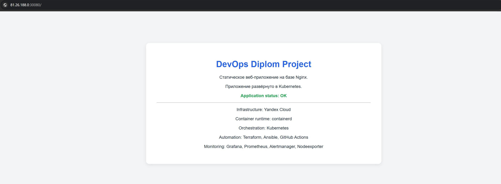


На данном этапе выполнены:
- Установлен Helm для управления Kubernetes-приложениями.
- Установлен Metrics Server для получения метрик CPU и памяти Kubernetes-узлов и Pod.
- Установлен Local Path Provisioner для динамического создания PersistentVolume.
- Установлен kube-prometheus-stack.
- Настроены Alertmanager, Prometheus и Grafana.
- Проверена корректность передачи метрик и визуализация.
- Проверена работа кластера Kubernetes и нашего приложения.

---

В рамках дипломного проекта реализована инфраструктура для развертывания и эксплуатации веб-приложения на базе Yandex Cloud и Kubernetes с использованием инструментов автоматизации DevOps.

Что реализовано:
- Создана облачная инфраструктура в Yandex Cloud, включающая виртуальную сеть, подсети, группы безопасности и три виртуальные машины в разных зонах доступности.
- Подготовлены серверы и автоматизирована установка Kubernetes-кластера с использованием kubeadm, containerd и Calico.
- Создан Docker-образ статического веб-приложения на базе Nginx и опубликован в GitHub Container Registry (GHCR).
- Настроен автоматический процесс сборки, проверки и публикации Docker-образа при публикации нового Git-тега версии (v*).
- Развернуто веб-приложение с тремя репликами, настроены Service типа NodePort и проверки работоспособности приложения.
- Установлен комплекс kube-prometheus-stack, включающий Prometheus, Grafana, Alertmanager, Node Exporter и kube-state-metrics. Настроено постоянное хранение данных мониторинга и ограничение потребления ресурсов.

Результат:
Создана работоспособная инфраструктура, позволяющая развертывать конвейеризированное веб-приложение в Kubernetes, автоматизировать сборку и публикацию его образа, а также контролировать состояние приложения и компонентов кластера с помощью системы мониторинга. В результате получено практическое решение, объединяющее облачную инфраструктуру, автоматизацию развертывания, контейнеризацию, оркестрацию и мониторинг в единую систему.
