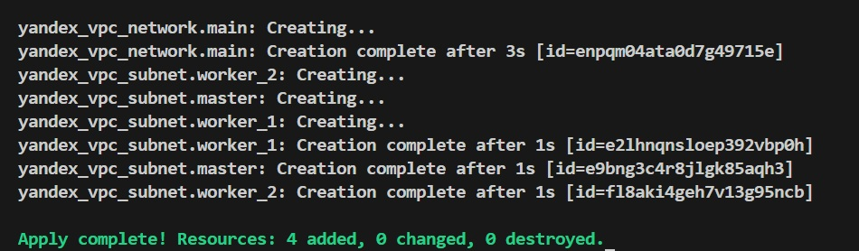
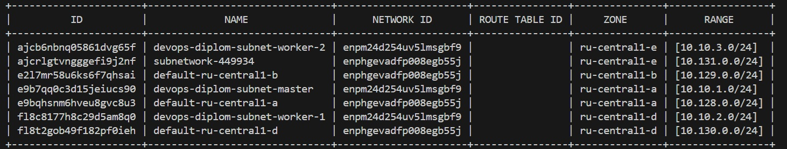
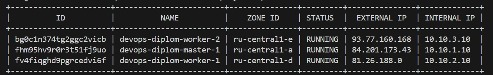
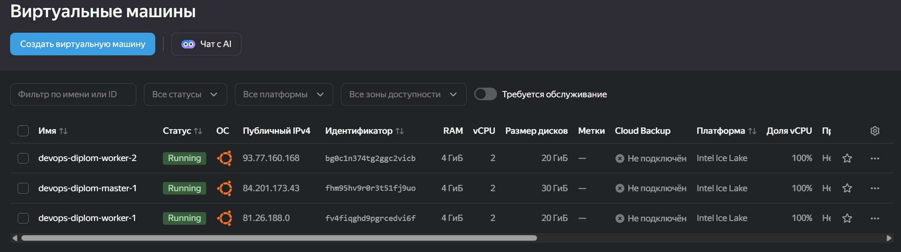

# Дипломный практикум в Yandex.Cloud 
Работу выполнил Винцентини С.Г.

## Цели:

1. Подготовить облачную инфраструктуру на базе облачного провайдера Яндекс.Облако.
2. Запустить и сконфигурировать Kubernetes кластер.
3. Установить и настроить систему мониторинга.
4. Настроить и автоматизировать сборку тестового приложения с использованием Docker-контейнеров.
5. Настроить CI для автоматической сборки и тестирования.
6. Настроить CD для автоматического развёртывания приложения.

---
### Архитектура решения и используемые технологии

| Компонент | Технология | Назначение |
| :--- | :--- | :--- |
| Облачный провайдер | Yandex Cloud | Инфраструктурная площадка |
| IaC | Terraform | Автоматизация создания ресурсов |
| Конфигурационное управление | Ansible | Настройка ОС и установка компонентов |
| Оркестрация | Kubernetes (v1.37.2) | Управление контейнеризованным приложением |
| Container Runtime | containerd (v2.4.2) | Среда выполнения контейнеров |
| Сетевой плагин (CNI) | Calico (v3.31.3) | Организация сети Pod-ов |
| Мониторинг | Prometheus / Grafana | Сбор и визуализация метрик |
| CI/CD | GitHub Actions / GHCR | Автоматизация сборки и публикации образов |

### Особенности экономии бюджета
В проекте будем придерживаться следующих правил:
- Не создавать лишние виртуальные машины.
- Использовать минимально необходимые вычислительные ресурсы.
- Worker Nodes делать прерываемыми.
- Не использовать платные дополнительные сервисы без необходимости.
- Удалять временные ресурсы после тестирования.
- Контролировать расходы в консоли Yandex Cloud.<br>

## 1. Подготовка облачной инфраструктуры Yandex Cloud с помощью Terraform

Необходимо создать облачную инфраструктуру, которая обеспечит:
1. Безопасное управление ресурсами Yandex Cloud через сервисный аккаунт.
2. Централизованное хранение Terraform State в Object Storage.
3. Создание виртуальной частной сети VPC.
4. Создание подсетей в разных зонах доступности.
5. Создание виртуальных машин для Kubernetes.
6. Настройку сетевой безопасности и доступа к серверам.
7. Возможность повторного выполнения terraform apply и terraform destroy без ручного создания зависимых ресурсов.

Архитектурное решение: будем использовать два независимых Terraform-проекта.
- bootstrap отвечает за создание сервисного аккаунта, его полномочий и Object Storage.
- infrastructure отвечает за создание основной инфраструктуры и использует удалённый backend для хранения состояния.

#### Предлагаемая инфраструктурная конфигурация:
|Ресурс|	Количество|	Назначение
|---------|---------|---------|
VPC|	1	|Частная сеть проекта
Подсети	|3	|Размещение узлов в разных зонах
Master Node	|1|	Управление Kubernetes
Worker Node	|2	|Запуск приложений
Object Storage	|1|	Хранение Terraform State
Service Account	|1	|Управление инфраструктурой
Security Groups	|2|	Управление сетевым доступом

### Создание Bootstrap-инфраструктуры
На этом шаге подготовим ресурсы, необходимые для дальнейшей автоматизации.

Создаваемые ресурсы:
1. Сервисный аккаунт terraform-deployer.
2. Назначение необходимых IAM-ролей.
3. Статический ключ доступа к Object Storage.
4. Бакет для Terraform State.
5. Версионирование объектов в бакете.

Для создания этих ресурсов первоначально используем текущую авторизацию пользователя Yandex Cloud, для первоначального запуска у пользователя должны быть права на создание сервисных аккаунтов и управление Object Storage. В частности, потребуются соответствующие IAM-права на каталог.

Подготовим файлы [providers.tf](https://github.com/w1ncez/Devops-Diplom-Project/blob/main/terraform/bootstrap/providers.tf) и [variables.tf](https://github.com/w1ncez/Devops-Diplom-Project/blob/main/terraform/bootstrap/variables.tf)

> Версию провайдера фиксируем в пределах ветки 0.126, чтобы избежать неожиданных изменений поведения конфигураций при последующих запусках.
> Версию Terraform фиксируем на уровне 1.6.3 или выше. Это необходимо, в частности, для корректной работы выбранной конфигурации S3 backend с Yandex Object Storage.
> 
> Переменные позволяют использовать одну конфигурацию в разных каталогах и проектах без изменения исходного кода.
> Например, название бакета задаётся отдельно, поскольку имена бакетов Object Storage должны быть уникальными.

Подготовим [main.tf](https://github.com/w1ncez/Devops-Diplom-Project/blob/main/terraform/bootstrap/main.tf)

Сервисный аккаунт *terraform-deployer* - это отдельная учётная запись, от имени которой будет выполняться управление основной инфраструктурой.
> Мы не используем для постоянной работы личный аккаунт владельца облака.

Назначаем следующие роли:
|Роль| Для чего нужна|
|---------|---------|
|compute.admin	|Создание и управление виртуальными машинами
vpc.admin	|Управление сетями, подсетями и группами безопасности
iam.serviceAccounts.user	|Использование сервисных аккаунтов при создании ВМ
storage.admin | Управление хранилищами

> Мы сознательно не назначаем роль admin на весь каталог.

Для нашего текущего состава инфраструктуры этих полномочий достаточно в части Compute Cloud и VPC.

**Статический ключ доступа** 

Ресурс *yandex_iam_service_account_static_access_key* создаёт пару ключей для работы с Object Storage через S3 API.

Она состоит из:
- *access_key* - идентификатор ключа;
- *secret_key* - секретная часть ключа.
Эти данные будут использоваться Terraform для обращения к удалённому хранилищу состояния.

**Object Storage**

Создаём бакет для хранения файлов состояния Terraform.
Параметр *versioning* включает версионирование объектов. Это позволяет восстановить предыдущую версию Terraform State при случайной перезаписи.

Параметр *max_size* ограничивает максимальный размер бакета одним гигабайтом.
*force_destroy = false* запрещает Terraform автоматически удалять бакет с находящимися в нём объектами.

Подготовим [outputs.tf](https://github.com/w1ncez/Devops-Diplom-Project/blob/main/terraform/bootstrap/outputs.tf)

> Выходные переменные позволят получить идентификаторы созданных ресурсов без необходимости искать их вручную в консоли.
> Параметр *sensitive = true* скрывает секретное значение при обычном выводе Terraform. Однако он не исключает сохранение секрета в Terraform State.

Подготовим **terraform.tfstate** и запишем туда реальные значения переменных, не передавая файл в Git, объявив заранее через [.gitignore](https://github.com/w1ncez/Devops-Diplom-Project/blob/main/.gitignore)

После подготовки файлов проверим форматирование, проведем валидацию и сформируем план 

```bash
terraform plan -out=bootstrap.tfplan
```
И применяем конфигурацию:
```bash
terraform apply "bootstrap.tfplan"
```
Убедимся, что ресурсы создались корректно
```bash
terraform state list
yandex_iam_service_account.terraform
yandex_iam_service_account_static_access_key.terraform
yandex_resourcemanager_folder_iam_member.compute_admin
yandex_resourcemanager_folder_iam_member.sa_user
yandex_resourcemanager_folder_iam_member.storage_admin
yandex_resourcemanager_folder_iam_member.vpc_admin
yandex_storage_bucket.terraform_state
```
В консоли сможем увидеть созданный SA-аккаунт и Бакет в OBS


#### Настраиваем удалённый Terraform State
Теперь перенесём State основного проекта из локального файла в созданный бакет. Это позволит хранить состояние инфраструктуры централизованно.
Находясь в директории bootstratp выполним
```bash
export AWS_ACCESS_KEY_ID="$(terraform output -raw access_key)"
export AWS_SECRET_ACCESS_KEY="$(terraform output -raw secret_key)"
```
Перейдем в каталог инфраструктуры и настроим [backend.tf](https://github.com/w1ncez/Devops-Diplom-Project/blob/main/terraform/infrastructure/backend.tf)

> Здесь:
> - bucket указывает на созданное хранилище.
> - key задаёт путь к файлу состояния внутри бакета.
> - endpoints указывает на S3 API Yandex Cloud.
> - skip_* отключают проверки AWS-специфичных параметров, которые не нужны для Yandex Object Storage.

Инициализируем backend, после чего настроим [providers.tf](https://github.com/w1ncez/Devops-Diplom-Project/blob/main/terraform/infrastructure/providers.tf) , [variables.tf](https://github.com/w1ncez/Devops-Diplom-Project/blob/main/terraform/infrastructure/variables.tf) и **terraform.tfvars**, они будут схожи с bootstrap манифестами

```bash
terraform fmt
terraform init
terraform validate
```

#### Создание VPC и подсетей
Для Kubernetes-кластера создадим одну виртуальную сеть и три подсети в разных зонах доступности.

##### Планируем адресацию
VPC: devops-network

Общая адресация: 10.10.0.0/16<br>
*ru-central1-a*
10.10.1.0/24
Master Node

*ru-central1-d*
10.10.2.0/24
Worker Node 1

*ru-central1-e*
10.10.3.0/24
Worker Node 2

> Такое разделение позволит разместить узлы Kubernetes в разных зонах доступности. При этом они останутся в одной VPC и смогут взаимодействовать по внутренним IP-адресам.

Теперь настроим [network.tf](https://github.com/w1ncez/Devops-Diplom-Project/blob/main/terraform/infrastructure/network.tf)

> В нём опишем:
> - одну виртуальную сеть VPC;
> - три подсети в разных зонах доступности;
> - адресное пространство 10.10.0.0/16;
> - отдельные диапазоны IP для Master и Worker узлов.

Проверим план, затем применим его:
```bash
terraform plan
terraform apply
```


Проверим список сетей и подсетей через yc
```bash
yc vpc network list
yc vpc subnet list
```



Создано: 
1. yandex_vpc_network.main - виртуальная сеть.
2. yandex_vpc_subnet.master - подсеть Control Plane.
3. yandex_vpc_subnet.worker_1 - подсеть первого Worker.
4. yandex_vpc_subnet.worker_2 - подсеть второго Worker.
Все три подсети находятся в одной VPC, но в разных зонах доступности.

#### Настраиваем Security Groups
Теперь необходимо определить, какой сетевой трафик разрешён между виртуальными машинами и извне.

Для Kubernetes нам понадобятся следующие порты:
| Порт	|Назначение|	Источник|
|----|----|----|
TCP 22|	SSH	| Внешний IP
TCP 6443|	Kubernetes API|	Внутренняя сеть и твой IP
TCP 2379-2380	|etcd	|Control Plane
TCP 10250	|Kubelet API|	Внутренняя сеть
UDP 4789	|Calico VXLAN|	Внутренняя сеть
TCP 30000-32767|	NodePort|	При необходимости

Настроим [security.tf](https://github.com/w1ncez/Devops-Diplom-Project/blob/main/terraform/infrastructure/security.tf) и применим манифест.


#### Создание виртуальных машин
Теперь подготовим три ВМ:
- master-1: узел управления Kubernetes.
- worker-1: первый рабочий узел.
- worker-2: второй рабочий узел.

Работать будем с такой конфигурацией:
|Параметр|	Master|	Worker|
|----|----|----|
vCPU|	2|	2
RAM	|4 ГБ|	4 ГБ
Диск	|30 ГБ|	20 ГБ
ОС	|Ubuntu 22.04 LTS|	Ubuntu 22.04 LTS
Публичный IP|	Да|	Да


> Публичные IP на всех узлах упростят первоначальную настройку Ansible и подключение по SSH

Подготовим [compute.tf](https://github.com/w1ncez/Devops-Diplom-Project/blob/main/terraform/infrastructure/compute.tf) и [outputs.tf](https://github.com/w1ncez/Devops-Diplom-Project/blob/main/terraform/infrastructure/outputs.tf)

> Для всех узлов используем образ *image_id = "fd8041m4h84kooeovknf"*

Применим манифест и убедимся, что все ресурсы compute созданы:
```bash
yc compute instance list
```


Итоговая иерархия структуры terraform:
```text
├── bootstrap
│   ├── bootstrap.tfplan
│   ├── main.tf
│   ├── outputs.tf
│   ├── providers.tf
│   ├── terraform.tfstate
│   ├── terraform.tfstate.backup
│   ├── terraform.tfvars
│   └── variables.tf
└── infrastructure
    ├── backend.tf
    ├── compute.tf
    ├── network.tf
    ├── outputs.tf
    ├── providers.tf
    ├── security.tf
    ├── terraform.tfvars
    ├── terraform.tfstate
    ├── tfplan
    └── variables.tf
```

## 2. Запуск и конфигурация Kubernetes кластера

Будем использовать связку containerd + kubeadm + kubelet + kubectl, а автоматизацию выполнять через Ansible. Это позволит не настраивать каждый сервер вручную и будет соответствовать архитектуре дипломного проекта.

### Проверка исходного состояния серверов
Перед установкой Kubernetes проверим операционную систему, ресурсы, swap и сетевые интерфейсы.
Скрипт проверки предикатов:
```bash
for ip in 84.201.173.43 81.26.188.0 93.77.160.168; do
    echo
    echo "========== $ip =========="

    ssh -i /home/w1nce/id_ed25519 \
        -o ConnectTimeout=10 \
        ubuntu@"$ip" '
        echo "--- HOSTNAME ---"
        hostname

        echo "--- OS ---"
        grep -E "PRETTY_NAME|VERSION_ID" /etc/os-release

        echo "--- CPU ---"
        nproc

        echo "--- MEMORY ---"
        free -h

        echo "--- DISK ---"
        df -h /

        echo "--- SWAP ---"
        sudo swapon --show

        echo "--- NETWORK ---"
        ip -br addr
    '
done
```

Результаты проверки:
Параметр	|Master	|Worker 1	|Worker 2
|----|----|----|----|
Версия ОС	|Ubuntu 24.04.5	|Ubuntu 24.04.5	|Ubuntu 24.04.5
CPU	|2	|2	|2
RAM	|3.8 GiB	|3.8 GiB	|3.8 GiB
Свободная RAM	|3.4 GiB	|3.4 GiB	|3.5 GiB
Диск	|29 GB	|19 GB	|19 GB
Swap	|Выключен	|Выключен	|Выключен
Внутренний IP	|10.10.1.10	|10.10.2.10	|10.10.3.10

#### Настраиваем Ansible

Подготовим [inventory/hosts.ini](https://github.com/w1ncez/Devops-Diplom-Project/blob/main/ansible/inventory/hosts.ini)

Проведем проверки 
```bash
ansible-inventory -i inventory/hosts.ini --graph
@all:
  |--@ungrouped:
  |--@kubernetes:
  |  |--@masters:
  |  |  |--master-1
  |  |--@workers:
  |  |  |--worker-1
  |  |  |--worker-2
```
```bash
ansible -i inventory/hosts.ini kubernetes -m ping
master-1 | SUCCESS => {
    "changed": false,
    "ping": "pong"
}
worker-2 | SUCCESS => {
    "changed": false,
    "ping": "pong"
}
worker-1 | SUCCESS => {
    "changed": false,
    "ping": "pong"
}
```
#### Создание Ansible-роли подготовки серверов

Подготовим [group_vars/kubernetes.yml](https://github.com/w1ncez/Devops-Diplom-Project/blob/main/ansible/group_vars/kubernetes.yml)

> kubernetes_packages содержит системные зависимости.
> kernel_modules содержит модули ядра, необходимые для сетевой работы контейнеров.
> sysctl_settings содержит параметры маршрутизации и обработки сетевого трафика.

#### Создаём задачи Ansible

 Подготовим [roles/kubernetes_prepare/tasks/main.yml](https://github.com/w1ncez/Devops-Diplom-Project/blob/main/ansible/roles/kubernetes_prepare/tasks/main.yml)

> Здесь мы:
> 1. Обновляем индекс пакетов APT.
> 2. Устанавливаем системные зависимости.
> 3. Отключаем swap, если он включён.
> 4. Убираем автоматическое подключение swap через /etc/fstab.
> 5. Настраиваем загрузку модулей ядра.
> 6. Загружаем необходимые модули.
> 7. Настраиваем параметры сетевого стека Linux.

#### Создаём Handler

Подготовим [roles/kubernetes_prepare/handlers/main.yml](https://github.com/w1ncez/Devops-Diplom-Project/blob/main/ansible/roles/kubernetes_prepare/handlers/main.yml)

> Handler выполняется только тогда, когда изменился файл сетевых параметров.

#### Создаём основной Playbook

Подготовим [playbook.yml](https://github.com/w1ncez/Devops-Diplom-Project/blob/main/ansible/playbook.yml)

> Параметр become: true позволяет выполнять системные команды с привилегиями root через sudo.


